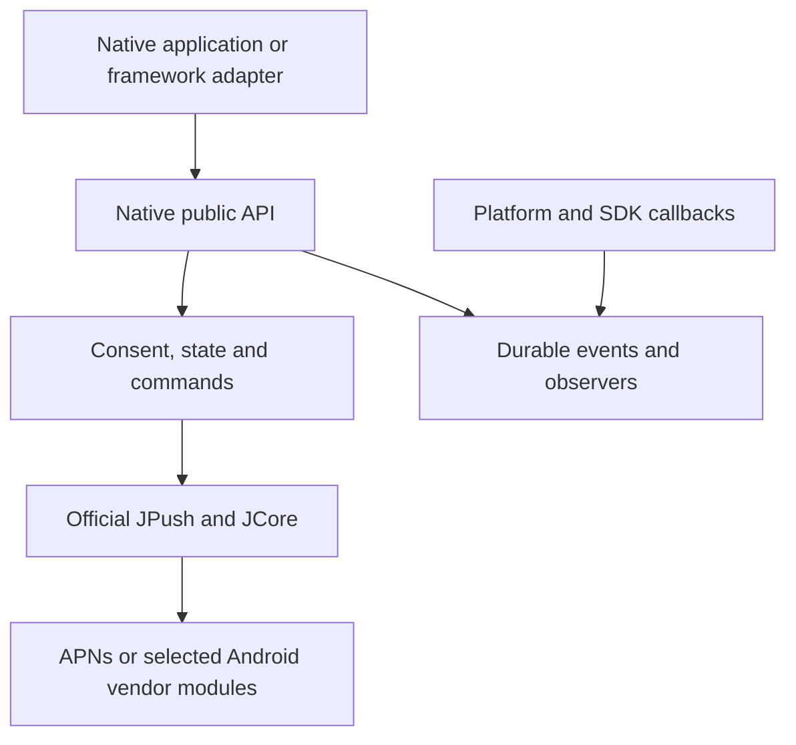

# Development

Run commands from the repository root. Package identity, minimum systems and pinned SDK versions are maintained in [plugin.json](plugin.json); public behavior is defined in the [shared contract](doc/contract.md). To integrate a released package, use the [platform guides](README-EN.md#integration).

Local tooling uses Python 3, Node.js and Bash; the CocoaPods specification check also requires CocoaPods. Platform-specific toolchains are listed below.

## Source ownership

| Location | Responsibility |
| --- | --- |
| `native/android` | Java core, Android callbacks, optional vendor modules and Maven metadata |
| `native/ios` | Objective-C core, Swift-facing API, APNs callbacks and privacy resources |
| `adapters/shared` | JSON command validation and native subscription ownership |
| `adapters/react-native` | RN transport, TurboModule/legacy entry points and optional Expo integration |
| `adapters/uniapp` | Legacy DCloud modules, JavaScript API and UNI integration guide |
| `uni_modules/Sandrox-Avvessa` | Classic UTS transport and uni-app x consumer facade |
| `scripts` | Local build, packaging and release tools |

The native cores depend only on platform APIs and official SDKs. Framework adapters call those cores instead of adding another JPush wrapper. SDK objects stay inside the core; public events expose JSON-compatible snapshots. Applications own authentication, routes, payload meaning, consent decisions and sending services.



Consumer hosts and device procedures live in the separate integration repository. Keep local configuration, SDK downloads, credentials, generated projects and investigation notes out of tracked files; see [repository conventions](AGENTS.md).

## Native implementation

### Android

`Avvessa` is process-scoped and explicitly initialized in the application process. The SDK service runs in `:pushcore`. Private providers restore consent before SDK components and synchronize later changes. The service provider restores the last initialized configuration through JPush's public initialization API, including process-local AppKey and vendor settings. A transactional consent/configuration snapshot blocks restoration after withdrawal until explicit initialization or resume. The manifest removes the SDK auto-init provider and optional location, phone-state, package-query and storage permissions.

A private presentation provider holds transient decisions in the application process. SDK builders in another process query it for the current context. Decisions follow the SDK message ID because the final notification ID may be assigned after construction. On Android 6 and later, instance tokens prevent removal from cancelling a newer notification that reused the same ID. The observable suppression methods and their limits belong to the [presentation contract](doc/contract.md#foreground-policy).

SQLite transactions coordinate persistence, deduplication and queue limits across processes. Receivers can record events before a UI subscriber exists. Locally rendered notification clicks use a direct PendingIntent Activity; vendor-managed notifications retain SDK entry points. Optional vendor artifacts add their SDK adapter, manifest declarations and installed-module marker without adding those dependencies to the base artifact.

### iOS

`AVPushClient` is a main-thread singleton observing SDK registration, connection and custom-message notifications. The native core does not swizzle or assign notification delegates. Hosts explicitly install its coordinator or forward callbacks; the [iOS guide](native/ios/README.md#cooperate-with-an-existing-notification-delegate) defines that integration.

The event store uses atomic JSON replacement in an application-support directory excluded from backup. File protection allows access after the first unlock. Storage failures preserve the original file. The store is process-local and is not intended for concurrent access from an app extension.

The privacy resource combines declarations from the pinned SDKs because static-library XCFrameworks do not automatically copy those files into every consumer. Ownership and packaging details are in [third-party notices](THIRD_PARTY_NOTICES.md#ios-privacy-resources).

### UNI bridges

The shared native bridge validates JSON commands and owns observer lifetimes. Legacy modules and UTS entry points forward to it. Classic JavaScript and the uni-app x UTS facade each use a single persistent event channel; DCloud must retain that callback. Adapters do not acknowledge events automatically.

iOS hooks capture APNs callbacks before page creation. Framework adapters opt into shared delegate installation on the managed notification center, adding observers to the native coordinator; other centers are unaffected. Public packages contain plugin code and SDK dependencies. Application-specific vendor resources belong in a separate consumer AAR, never in a redistributed plugin package.

### React Native

The RN adapter is source development only; it is absent from the published release matrix. Its package remains private until native builds, consumer checks and device acceptance establish a release contract. The consumer targets React Native 0.81 and Expo SDK 54. Do not infer RN acceptance from native or UNI device results.

Host setup, Expo options and API examples belong to the [RN integration guide](adapters/react-native/README.md).

`adapters/react-native/inputs.json` defines the canonical package inputs. The JavaScript facade and declarations come from the existing UNI JavaScript contract, the command layer from `adapters/shared`, and the iOS core from `native/ios`. No copy of those implementations is maintained inside the adapter. To materialize a source package without building or installing:

```sh
python3 scripts/prepare-react-native.py --output .build/react-native/package
```

The integration repository's isolated source preparer reads the same input manifest. Its Android target builds local core/vendor AARs; its iOS target copies core sources into the local Pod. The public stable host, npm artifact registry and release receipt remain separate.

RN commands resolve one JSON envelope. Subscription observations use a separate native event channel; the JS transport buffers replay until acknowledgement, releases its listener after the final unsubscribe and detaches owned observers on hot replacement. React runtime invalidation closes native bridge ownership without stopping push or acknowledging events. The iOS session receives launch options and activation callbacks from its host instead of referencing a DCloud lifecycle singleton.

The optional Expo Pod uses [AppDelegate subscribers](https://docs.expo.dev/modules/appdelegate-subscribers/). Codegen follows the [RN 0.81 module configuration](https://reactnative.dev/docs/0.81/the-new-architecture/using-codegen). Ordinary RN hosts forward callbacks explicitly; the native cores contain neither framework dependency.

Local transport and configuration regressions:

```sh
node --test adapters/react-native/tests/*.test.mjs adapters/react-native/tests/*.test.cjs
node --test adapters/uniapp/tests/*.test.mjs
```

These isolated tests do not replace Android/iOS builds or device checks. Verify both module architectures, APNs forwarding, other notification delegates, React reload/unmount, pending replay, permissions and all consumer scenarios before publication. Changes to shared iOS session construction also require UNI bridge compilation and lifecycle regression.

## Android builds and tests

Use JDK 17 and Android SDK API 36. Set `JAVA_HOME` and `ANDROID_HOME`, or set `sdk.dir` in the ignored `native/android/local.properties`.

```sh
native/android/gradlew -p native/android \
  :avvessa:testDebugUnitTest :avvessa:lintRelease assembleRelease publish
```

`publish` writes the base and optional modules, POMs, source jars and Gradle metadata only to `native/android/build/maven`. A local consumer can add that directory as a Maven repository. These builds do not need AppKeys or sending credentials.

Storage and policy tests exclude SDK startup components and cover persistence, acknowledgement, identity aliases, eviction, concurrent access and consent withdrawal. Android and iOS policy checks share `tests/notification-policy.json`. Two isolated SDK fixtures additionally cover notification dispatch and service-process restoration:

- Dispatch tests use the pinned JPush dispatcher with JCore network calls replaced by a shadow. They cover ordinary payloads without `display_foreground`, explicit gating, silence/removal and context changes. Review the fixture's SDK-internal entry points when upgrading JPush.
- Restoration tests exercise SDK initialization and AppKey validation with service/network dispatch isolated. They cover retained configuration, repeated consent synchronization, invalid configuration, withdrawal and resume.

These fixtures do not register a device or establish a push connection. The pinned Gradle wrapper and Android Gradle Plugin are the local build baseline. Some upstream jars emit R8 stack-map warnings; when changing the SDK or shrinker, inspect those warnings and check a release build.

## iOS builds and tests

Use Xcode with the iOS SDK:

```sh
xcodebuild -list
xcodebuild -scheme Avvessa -destination 'generic/platform=iOS' \
  -derivedDataPath .build/ios-device CODE_SIGNING_ALLOWED=NO build
xcodebuild -scheme Avvessa -destination 'generic/platform=iOS Simulator' \
  -derivedDataPath .build/ios-simulator CODE_SIGNING_ALLOWED=NO build
./scripts/check-ios-storage.sh
./scripts/check-ios-notifications.sh
pod ipc spec Avvessa.podspec
```

The shell checks compile storage, configuration, policy and delegate coordination against macOS Foundation and UserNotifications. They cover storage upgrades, selective presentation, delegate ownership, duplicate completion, recursion and timeouts without loading JPush or registering APNs. This test harness does not add macOS product support.

## Metadata and privacy resources

```sh
python3 scripts/check-metadata.py
python3 scripts/ios-privacy.py \
  --jpush-sdk /path/to/pinned/jpush-sdk-checkout \
  --jcore-sdk /path/to/pinned/jcore-sdk-checkout --check
```

After an SDK update, review the upstream device/simulator declarations, then run the privacy command without `--check` to regenerate the bundled union. Keep package declarations and `Package.resolved` consistent with `plugin.json`.

## UNI package builds and checks

Install the Android and iOS toolchains above and the official DCloud Android AAR and iOS SDK locally. Resolve the root Swift package and build the adapters:

```sh
xcodebuild -resolvePackageDependencies -scheme Avvessa -derivedDataPath .build/uniapp-sdk
python3 scripts/package-uniapp.py \
  --source-packages .build/uniapp-sdk/SourcePackages \
  --dcloud-android-aar /absolute/path/to/uniapp-v8-release.aar \
  --dcloud-ios-sdk /absolute/path/to/classic-ios-sdk
```

Local packages are written to `dist/uniapp/`. Optional `--vendors huawei,honor,xiaomi,meizu,oppo,vivo` selects transports for a source build; formal release packaging instead includes an inactive vendor kit. Application resources are prepared separately as described in the [UNI guide](adapters/uniapp/README.md#配置-android).

UNI iOS archives contain arm64 device frameworks. `scripts/build-uniapp-ios.py --sdk iphonesimulator` builds simulator components separately; device frameworks cannot be used in a simulator. The builder also links an unsigned probe for missing SDK symbols and Swift runtime dependencies.

After packaging:

```sh
node --test adapters/uniapp/tests/*.test.mjs
python3 -m unittest discover -s scripts/tests -v
native/android/gradlew -p adapters/android \
  -PavvessaCoreAar="$PWD/native/android/avvessa/build/outputs/aar/avvessa-release.aar" \
  :bridge:testDebugUnitTest
avvessa_version=$(python3 -c 'import json; print(json.load(open("plugin.json"))["version"])')
python3 scripts/check-uniapp-android.py "dist/uniapp/avvessa-uniapp-${avvessa_version}.zip"
python3 scripts/check-uniapp-uts.py "dist/uniapp/avvessa-uniapp-${avvessa_version}.zip" \
  --hbuilder-contents /absolute/path/to/HBuilderX \
  --classic-ios-sdk /absolute/path/to/classic-ios-sdk \
  --x-android-sdk /absolute/path/to/uniapp-x-android-sdk \
  --x-ios-sdk /absolute/path/to/uniapp-x-ios-sdk --x-renderer vapor
```

For Android packages with selected vendors, add `--configuration-aar` and `--consumer-manifest` from the consumer resource generator. A legacy package also needs `--dcloud-android-aar`. The Android check links resources and bytecode and inspects the merged manifest. The UTS check compiles Kotlin and Swift for classic and X runtimes. `--hbuilder-contents` points to the directory containing HBuilderX's `plugins`; `--x-renderer` must match the supplied SDK (`vapor` or `native`). Use matching HBuilderX and DCloud SDK versions.

These checks build or link without installing or launching applications. Push delivery, APNs signing, notification interaction and manufacturer rendering need physical-device checks in the integration repository. Distribution preparation, acceptance requirements and publication commands belong to [RELEASING.md](RELEASING.md).
