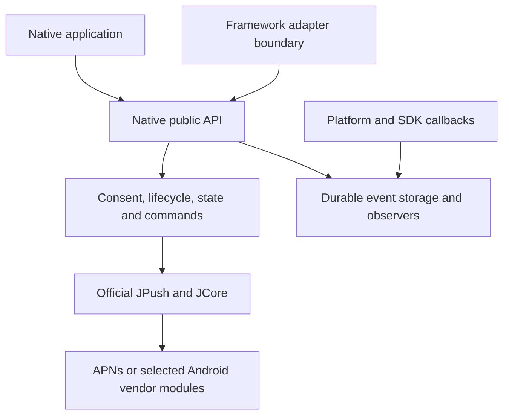

# Native architecture

The adapter boundary describes dependency direction; it is not a claim that framework adapters are included.

## Ownership

The Android implementation uses Java and the iOS implementation uses Objective-C with explicit Swift names for callback forwarding. Both can be called without a framework runtime. SDK objects stay inside the core; public events expose JSON-compatible snapshots.

The core owns initialization, native callback capture, notification defaults, event persistence and SDK operation correlation. Applications own their consent decision, server configuration, application signing, payload meaning, login, account association and navigation. A notification click can open the Android launcher; it cannot select a business screen.

## Android

`Avvessa` is process-scoped. Initialize it in the application process. The SDK service runs in `:pushcore`; private providers restore consent before SDK components and synchronize later consent changes. The SDK's automatic initialization provider and SDK-owned optional location, phone-state, package-query and storage permissions are removed by manifest merge rules.

SQLite transactions coordinate persistent state, deduplication and queue limits across processes. Native receivers can record messages before a UI or framework subscriber exists. Locally rendered notifications use a direct PendingIntent Activity for click handling. Factory-managed notifications continue through the SDK's own entry points.

The base artifact does not depend on vendor SDKs. Each optional vendor artifact adds its official adapter, required native declarations and an installed-module marker. These markers describe the build, not successful registration or delivery.

## iOS

`AVPushClient` is a main-thread singleton. It observes SDK registration, connection and custom-message notifications. It does not swizzle application delegates or assign itself as the notification center delegate. A host either assigns the client explicitly or forwards the relevant callbacks.

APNs registration and system authorization are separate. A notification response carries its action metadata beside the untouched APNs dictionary. The documented JPush message marker identifies notifications owned by the client.

The event store uses atomic JSON replacement in an application-support directory excluded from backup. File protection permits access after the first device unlock. Storage failures are surfaced without discarding the original file. The store is process-local and is not intended for concurrent access from an app extension.

## Dependency and artifact boundaries

JPush and JCore are pinned separately. JCore is Jiguang's native infrastructure, not a React Native component. Framework adapters must use this core instead of adding another framework push wrapper and duplicating SDK initialization.

Android publishes AARs, source jars, POMs and Gradle module metadata to a local Maven directory. iOS provides a source Swift package and a CocoaPods specification. No SDK binary is checked into this repository.

The iOS resource manifest retains the combined declarations shipped with the pinned official SDKs. Resource packaging is necessary because their static-library XCFramework layout does not automatically copy those files into every consumer app.

Host applications and delivery acceptance belong to a separate integration repository. Compile checks and isolated storage checks do not establish push delivery, APNs signing, device interaction or release eligibility.

## UNI adapters

The shared Android and iOS bridge validates JSON commands and owns observer lifetimes. The legacy DCloud module and UTS entry points forward to that bridge. Classic JavaScript uses one persistent event channel; uni-app x uses a UTS facade in the consumer runtime with the same single-channel subscription model. iOS application hooks capture APNs callbacks before page creation, allowing the core to persist cold-start interactions. No adapter acknowledges an event automatically.

Public UNI packages contain only code and selected SDK dependencies. Application-specific vendor resources are assembled separately into a consumer AAR. This artifact belongs to the host and must not be included in a redistributed plugin package.
